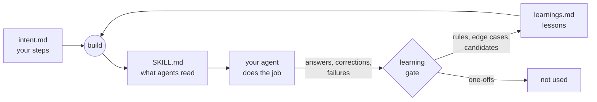

# bluer

**Agent skills you write in three lines, that get better every time they run.**

[](https://github.com/BulldromeQ/bluer-skills/actions/workflows/ci.yml)
[](LICENSE)

> 青出于蓝而胜于蓝: *blue comes from the indigo plant, yet it is bluer than the plant.*
> You write the plant. bluer makes it bluer.

You write a skill the way you would tell a person. Your agent uses it, asks
questions, gets corrected, makes mistakes. bluer turns each of those into a
lesson and folds the good ones back into the skill. Your own short version stays
short, in your words. The skill your agent reads grows the detail.

> **Status: early.** The `bluer` CLI works today (create, learn, versions,
> rollback, adopt, link to Claude Code). It is not on npm yet. Next: a Claude Code
> plugin that captures lessons on its own. See the [roadmap](#roadmap).

## Why

Skills are the best way to teach an agent how *you* want a job done. But:

- **They are hard to write.** A skill that works needs a precise description and
  the right detail. Most people give up, or never start.
- **Good skills are unreadable.** After a few rounds of fixes, a skill is long
  and dense. You can no longer see what it does.
- **They rot or bloat.** Nobody updates them, or the agent adds every edge case
  until the real rules are lost.

bluer fixes this by keeping two versions of every skill: **yours**, and **the
one that learns**.

## How it works

You write this, in chat or on the command line:

```text
Doing house work, 1. clean the table, 2. clean the restroom, 3. clean the kitchen
```

bluer saves it as `intent.md`, your version:

```markdown
# Doing house work

1. clean the table
2. clean the restroom
3. clean the kitchen
```

Your agent does the job, and things happen. You say *"wipe the table with a damp
cloth, then dry it"* (three times, because the agent keeps forgetting). You say
*"never use bleach: we have a cat."* The agent finds that the kitchen sink is
blocked. Today there is a birthday cake on the table.

bluer sorts each lesson through its **learning gate**, then builds the
`SKILL.md` your agent reads (shown without its frontmatter):

```markdown
# Doing house work

Do these steps in order.

## 1. clean the table

- Wipe with a damp cloth, then dry it

## 2. clean the restroom

## 3. clean the kitchen

## General rules

- Never use bleach: we have a cat

## Edge cases

Rare cases are in references/learned-edge-cases.md. Read it when a step does not go as planned.
```

The blocked sink went to the edge-case file, which the agent reads only when it
needs to. The cake was about one day only, so bluer does not use it.

Next week you add one line to your version:

```markdown
4. clean the living room
```

bluer rebuilds. Everything it learned about steps 1 to 3 stays, and step 4
starts to learn.



## The learning gate

Not everything an agent learns belongs in a skill. bluer gives each lesson a
tier:

| Tier | Where it goes | When |
|---|---|---|
| **Rule** | The skill itself | You said "always" or "never", it prevented a costly mistake, or it happened 3 times |
| **Edge case** | A side file, read only when needed | It happened twice, or it matters but is rare |
| **Candidate** | Waits; the skill does not change | It happened once. It expires if it does not come back in 30 days or 10 runs |
| **Ignored** | Not used | It was about this one run only |

You can make the gate `strict` or `eager`. The default is `balanced`.

## You stay in control

- **Your words are never changed for you.** bluer never edits your version on
  its own. *(Planned:)* if the skill drifts away from what you wrote, bluer
  shows you why and proposes a new line, and changes it only when you say yes.
- **Every change is a version.** `bluer history` shows them; `bluer rollback`
  undoes what was learned. Rollback never touches your own steps.
- **Learning is automatic, and you can slow it down.** Set a skill, or all
  skills, to `review` (you approve each lesson) or `off`.
- **Hand edits are not lost.** If you edit the built `SKILL.md`, bluer saves a
  copy and keeps it as a lesson to review, instead of overwriting it.
- **Local and private.** No telemetry, no account and no API key. Your agent does
  the thinking; bluer handles files and versions.

## Works with what you have

- **Standard skills.** The built skill is a normal [Agent Skills](https://agentskills.io)
  `SKILL.md`. It works in any agent that reads skills, with or without bluer.
- **Your existing skills.** `bluer adopt <folder>` keeps the original as version
  0 and lets it start to learn.
- **Your favorite skill creator** *(planned).* Use bluer's own, or plug in one
  you already like. bluer takes over after the first draft.
- **Skills from other people** *(planned).* Keep the author's version, add your
  own lessons on top, and still get the author's updates.

| Agent | Status |
|---|---|
| Claude Code | Skills link into `~/.claude/skills` today. Plugin with automatic capture: next |
| Gemini CLI | Planned |
| OpenAI Codex | Planned |
| Cursor | Planned |
| GitHub Copilot | Planned |

## Try it

Requires Node.js 22.18 or later, and git.

```bash
git clone git@github.com:BulldromeQ/bluer-skills.git
cd bluer-skills && npm install
alias bluer="node $PWD/src/main.ts"

export BLUER_HOME=/tmp/bluer-try      # optional: try it without touching ~/.bluer
bluer new "Doing house work, 1. clean the table, 2. clean the restroom, 3. clean the kitchen"
bluer learn doing-house-work "Wipe with a damp cloth, then dry it" --step 1
bluer learn doing-house-work "Never use bleach: we have a cat" --always
bluer status doing-house-work
bluer history doing-house-work
```

`bluer new` links the skill into `~/.claude/skills`, so Claude Code can use it at
once. Add `--no-link` to skip that.

| Command | What it does |
|---|---|
| `bluer new "<title>, 1. <step>, 2. <step>"` | Create a skill from plain steps |
| `bluer learn <skill> "<lesson>"` | Teach a skill something (`--step`, `--always`, `--impact`, `--one-off`) |
| `bluer build <skill>` | Rebuild after you edit `intent.md` |
| `bluer status <skill>` | Version, lessons by tier, hand edits |
| `bluer history <skill>` / `bluer rollback <skill> <version>` | See and undo versions |
| `bluer approve <skill> --all` | Approve lessons that wait for review |
| `bluer adopt <folder>` | Bring an existing skill into bluer |
| `bluer link <skill> --replace` | Swap an agent's copy of a skill for the bluer one |

Run `bluer help` for every option.

## FAQ

**Do I need to know how to write a skill?** No. Write steps the way you would
tell a person. bluer and your agent do the rest.

**What if it learns something wrong?** Roll back with one command, or set the
skill to `review` so that you approve each lesson first.

**Does anything leave my machine?** No. Sharing lessons with a skill's author is
planned, and it will always show you the exact text and wait for your yes.

**Can I use my bluer skills without bluer?** Yes. `SKILL.md` is a normal skill
file.

**How is this different from a memory file like `CLAUDE.md`?** A memory file is
one long list for everything. bluer keeps each lesson with the task it belongs
to, keeps rare cases out of the way, and versions every change.

## Roadmap

- [x] Design ([docs/design.md](docs/design.md))
- [x] CLI core: create, learning gate, build, versions, rollback, adopt, link
- [ ] Claude Code plugin: `/bluer` in chat, automatic lesson capture, run counting
- [ ] Trigger tests, and a test gate on every automatic change
- [ ] Intent drift reports, size budget for skills
- [ ] New-skill drafts for work that repeats
- [ ] Shared skills with a personal layer
- [ ] Gemini CLI, OpenAI Codex, Cursor and GitHub Copilot adapters

## Contributing

Read [AGENTS.md](AGENTS.md) for how to build and test, and
[docs/design.md](docs/design.md) for how bluer works and what is still open.
[docs/lessons-from-practice.md](docs/lessons-from-practice.md) explains the
hard-won rules behind the design.

## Credits

The lesson-capture design builds on ideas from
[claude-reflect](https://github.com/BayramAnnakov/claude-reflect) by Bayram
Annakov (MIT), which captures corrections from Claude Code sessions.

## License

[MIT](LICENSE)
