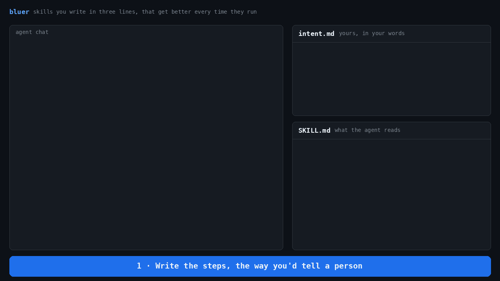
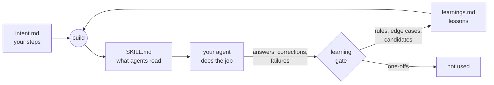

#  bluer

**bluer skills: agent skills you write in three lines, that get better every time they run.**
For Claude Code and Gemini CLI today; OpenAI Codex, Cursor and GitHub Copilot next.

[](https://github.com/BulldromeQ/bluer-skills/actions/workflows/ci.yml)
[](LICENSE)

> 青出于蓝而胜于蓝: *blue comes from the indigo plant, yet it is bluer than the plant.*
> You write the plant. bluer makes it bluer.



You write a skill the way you would tell a person. Your agent uses it, asks
questions, gets corrected, makes mistakes. bluer turns each of those into a
lesson and folds the good ones back into the skill. Your own short version stays
short, in your words. The skill your agent reads grows the detail.

**You see every change, and one sentence undoes it.** Each time a skill learns
something, your agent tells you in one line:

```text
weekly-update learned: "keep it under 150 words". It does this every time now. Say "undo that" to remove it.
```

bluer never changes your own steps, and every change is a version you can roll
back.

> **Status: early.** The Claude Code plugin and the Gemini CLI extension work:
> create skills in chat, and your agent records what it learns while it uses
> them. Other agents and the npm package come later. See the [roadmap](#roadmap).

## Install

bluer runs on [Node.js](https://nodejs.org) 20 or later. You do not need to
install it first. If your computer does not have it, bluer tells you when your
agent starts. Say "set up bluer", and it downloads Node.js from nodejs.org for
bluer only. It changes nothing else on your computer.

### Claude Code

In Claude Code, run:

```text
/plugin marketplace add BulldromeQ/bluer-skills
/plugin install bluer@bluer-skills
```

Or, on Claude Code 2.1.275 or later, in one step:

```text
/plugin install bluer --marketplace BulldromeQ/bluer-skills
```

### Gemini CLI

In a terminal, run:

```bash
gemini extensions install https://github.com/BulldromeQ/bluer-skills
```

The extension adds the `bluer` skill and `/bluer:new`, `/bluer:teach` and
`/bluer:status`. bluer links your skills into `~/.agents/skills`, where Gemini
CLI finds them.

### Then

Then just ask: *"Make a skill for my weekly update email: 1. read my notes from
this week, 2. write a short summary, 3. email it to my team."*

## Why

Skills are the best way to teach an agent how *you* want a job done. But:

- **They are hard to write.** A skill that works needs a precise description and
  the right detail. Most people give up, or never start.
- **Good skills are unreadable.** After a few rounds of fixes, a skill is long
  and dense. You can no longer see what it does.
- **They rot or bloat.** Nobody updates them, or the agent adds every edge case
  until the real rules are lost.

bluer fixes this by keeping two versions of every skill: **yours**, and **the
one that learns**.

## How it works

Take a job many people already give an agent: the weekly update email.

**1. You write the steps, in your own words.** In chat, or on the command line:

```text
Weekly update, 1. read my calendar and notes from this week, 2. write a short summary, 3. email it to my team
```

bluer saves this as `intent.md`. It is yours, and it stays this short.

**2. Your agent does the job, and bluer learns.** Over a few weeks:

| What happened | What bluer did with it |
|---|---|
| You said "keep it under 150 words" and "always CC my manager" | **Rules** at once, because you stated them as rules |
| Three times you asked to put the bug fixes at the end | **Rule**, after the third time |
| Twice you were on vacation, and the update came out empty | **Edge case**, in a side file the agent reads only when needed |
| You said "maybe use bullet points", once | **Candidate**: it waits to see if you say it again |
| You said "this week, leave out the offsite planning" | **One-off**: not used next week |

Each time, your agent shows you the one-line receipt. If a lesson is wrong, say
"undo that" and it is gone.

**3. bluer builds the skill your agent reads.** This is the `SKILL.md` it wrote
(shown without its frontmatter):

```markdown
# Weekly update

Do these steps in order.

## 1. read my calendar and notes from this week

## 2. write a short summary

- Keep it under 150 words
- Put bug fixes at the end

## 3. email it to my team

- Always CC my manager

## Edge cases

Rare cases are in references/learned-edge-cases.md. Read it when a step does not go as planned.
```

**4. You change your version, and nothing learned is lost.** Add one line to
`intent.md`:

```markdown
4. add my plan for next week
```

bluer rebuilds. The rules for steps 2 and 3 stay, and step 4 starts to learn.



## You stay in control

- **You see every lesson.** Your agent shows a one-line receipt for each one:
  what the skill learned, and whether it is a rule, an edge case or only noted.
- **One sentence undoes a lesson.** Say "undo that", and the lesson is gone. It
  stays gone, even if the same thing comes up again, until you ask for it back.
- **Your words are never changed for you.** bluer never edits your version on
  its own. *(Planned:)* if the skill drifts away from what you wrote, bluer
  shows you why and proposes a new line, and changes it only when you say yes.
- **Every change is a version.** `bluer history` shows them; `bluer rollback`
  undoes everything learned after a version. Rollback never touches your own
  steps.
- **Learning is automatic, and you can slow it down.** Set a skill, or all
  skills, to `review` (you approve each lesson) or `off`.
- **Hand edits are not lost.** If you edit the built `SKILL.md`, bluer saves a
  copy and keeps it as a lesson to review, instead of overwriting it.
- **Local and private.** No telemetry, no account and no API key. Your agent does
  the thinking; bluer handles files and versions.


## The learning gate

Not everything an agent learns belongs in a skill. bluer gives each lesson a
tier:

| Tier | Where it goes | When |
|---|---|---|
| **Rule** | The skill itself | You stated it as a rule ("always CC my manager"), it prevented a costly mistake, or it happened 3 times |
| **Edge case** | A side file, read only when needed | It happened twice, or it matters but is rare |
| **Candidate** | Waits; the skill does not change | It happened once. It expires if it does not come back in 30 days or 10 runs |
| **Ignored** | Not used | It was about this one run only |

You can make the gate `strict` or `eager`. The default is `balanced`.

## Works with what you have

- **Standard skills.** The built skill is a normal [Agent Skills](https://agentskills.io)
  `SKILL.md`. It works in any agent that reads skills, with or without bluer.
- **Your existing skills.** `bluer adopt <folder>` keeps the original as version
  0 and lets it start to learn.
- **Your favorite skill creator** *(planned).* Use bluer's own, or plug in one
  you already like. bluer takes over after the first draft.
- **Skills from other people** *(planned).* Keep the author's version, add your
  own lessons on top, and still get the author's updates.

| Agent | Status |
|---|---|
| Claude Code | Works: plugin with `/bluer:new`, `/bluer:teach`, `/bluer:status` and automatic lesson capture |
| Gemini CLI | Works: extension with `/bluer:new`, `/bluer:teach`, `/bluer:status` and automatic lesson capture |
| OpenAI Codex | Planned |
| Cursor | Planned |
| GitHub Copilot | Planned |

## Try the CLI

The plugin runs the `bluer` CLI for you. To use it directly from a clone (Node.js
22.18 or later, and git):

```bash
git clone git@github.com:BulldromeQ/bluer-skills.git
cd bluer-skills && npm install
alias bluer="node $PWD/src/main.ts"

export BLUER_HOME=/tmp/bluer-try      # optional: try it without touching ~/.bluer
bluer new "Weekly update, 1. read my calendar and notes from this week, 2. write a short summary, 3. email it to my team"
bluer learn weekly-update "Keep it under 150 words" --step 2
bluer learn weekly-update "Always CC my manager" --step 3 --always
bluer forget weekly-update --last
bluer status weekly-update
bluer history weekly-update
```

`bluer new` links the skill into the skills folder of each agent you have
(`~/.claude/skills` for Claude Code, `~/.agents/skills` for Gemini CLI), so the
agent can use it at once. Add `--no-link` to skip that.

| Command | What it does |
|---|---|
| `bluer new "<title>, 1. <step>, 2. <step>"` | Create a skill from plain steps |
| `bluer learn <skill> "<lesson>"` | Teach a skill something (`--step`, `--always`, `--impact`, `--one-off`) |
| `bluer build <skill>` | Rebuild after you edit `intent.md` |
| `bluer status <skill>` | Version, and each lesson the skill has learned |
| `bluer history <skill>` / `bluer rollback <skill> <version>` | See and undo versions |
| `bluer forget <skill> --last` / `bluer restore <skill> <id>` | Undo a lesson, or bring it back |
| `bluer approve <skill> --all` | Approve lessons that wait for review |
| `bluer adopt <folder>` | Bring an existing skill into bluer |
| `bluer link <skill> --replace` | Swap an agent's copy of a skill for the bluer one |

Run `bluer help` for every option.

## FAQ

**Do I need to know how to write a skill?** No. Write steps the way you would
tell a person. bluer and your agent do the rest.

**What if it learns something wrong?** Say "undo that". To go further back, ask
your agent to roll the skill back to an earlier version. To approve each lesson
before it is used, set the skill to `review`.

**Will it ask me to approve commands?** Your agent asks before it runs the
`bluer` command the first time. In Claude Code, choose "don't ask again" for
`~/.bluer/bin/bluer`. In Gemini CLI, choose "Allow for all future sessions".
That path stays the same across updates.

**My agent says bluer needs Node.js. What do I do?** Say "set up bluer". Your
agent asks before it downloads anything. bluer then downloads the official
Node.js from nodejs.org into `~/.bluer/runtime`: a 30 to 60 MB download, about
140 MB on disk. It checks the file against a checksum pinned in bluer, and
changes nothing else on your computer. Then restart your agent. You can also
install Node.js yourself from [nodejs.org](https://nodejs.org). If Node.js is
installed in an unusual folder, set `BLUER_NODE` to its full path. Setup works on
macOS and Linux; Windows is not supported yet.

**Does anything leave my machine?** No. Sharing lessons with a skill's author is
planned, and it will always show you the exact text and wait for your yes.

**How do I know it learns the right things?** The
[learning eval](evals/README.md) runs real agent sessions: stated rules,
small corrections, one-offs, repeats, undo, thanks and questions, passwords and
instructions hidden in files. It checks what bluer recorded each time. Claude
Code with Sonnet passes 23 of 23 ([results](evals/learning/RESULTS.md)).

**Can I use my bluer skills without bluer?** Yes. `SKILL.md` is a normal skill
file.

**How is this different from a memory file like `CLAUDE.md`?** A memory file is
one long list for everything. bluer keeps each lesson with the task it belongs
to, keeps rare cases out of the way, and versions every change.

## Roadmap

- [x] Design ([docs/design.md](docs/design.md))
- [x] CLI core: create, learning gate, build, versions, rollback, adopt, link
- [x] Claude Code plugin: `/bluer:new` in chat, automatic lesson capture, run counting
- [x] Learning eval: real sessions check what the agent records
- [ ] Trigger tests, and a test gate on every automatic change
- [ ] Intent drift reports, size budget for skills
- [ ] New-skill drafts for work that repeats
- [ ] Shared skills with a personal layer
- [x] Gemini CLI extension
- [ ] OpenAI Codex, Cursor and GitHub Copilot adapters

## Contributing

Read [AGENTS.md](AGENTS.md) for how to build and test, and
[docs/design.md](docs/design.md) for how bluer works and what is still open.
[docs/lessons-from-practice.md](docs/lessons-from-practice.md) explains the
hard-won rules behind the design.

## Credits

The lesson-capture design builds on ideas from
[claude-reflect](https://github.com/BayramAnnakov/claude-reflect) by Bayram
Annakov (MIT), which captures corrections from Claude Code sessions.

## License

[MIT](LICENSE)
